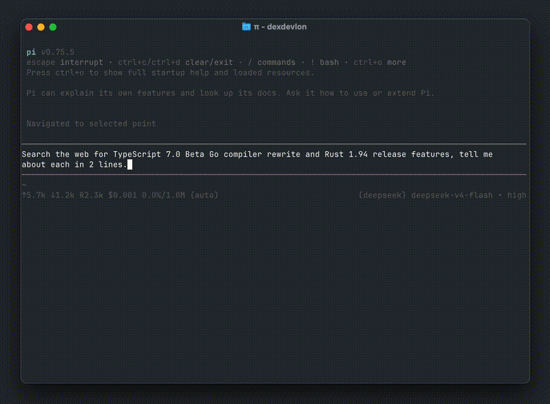

# pi-deepseek-search



```bash
pi install npm:pi-deepseek-search
```

Adds web search to Pi using DeepSeek's `web_search_20260209` server side tool (previously undocumented). Only available on DeepSeek's Anthropic-compatible endpoint, so this switches your search calls there automatically. No extra API keys or config needed if you use DeepSeek in Pi.

> May 26, 2026: DeepSeek has now [officially documented](https://api-docs.deepseek.com/quick_start/agent_integrations/claude_code) the Anthropic API web search tool support.

## Limitations

Only works with DeepSeek models. The search runs on DeepSeek's servers during inference, so you can't use it with Anthropic, OpenAI, or any other provider.

Defaults to `deepseek-v4-flash`. Set `DEEPSEEK_SEARCH_MODEL` to change it.

Read more: [Using DeepSeek's undocumented web search in Pi](https://musaab.io/posts/2026/deepseek-search)

[npm](https://www.npmjs.com/package/pi-deepseek-search) · [GitHub](https://github.com/bxff/pi-deepseek-search) · [pi.dev](https://pi.dev/packages/pi-deepseek-search)


## Prime Agent

Prime Agent users: install the separate [`prime-deepseek-search`](https://www.npmjs.com/package/prime-deepseek-search) package:

```bash
prime-agent package install npm:prime-deepseek-search
```

It provides the `deepseek-search` skill (`await deepseek_search("...")`) instead of the `web_search` tool.
